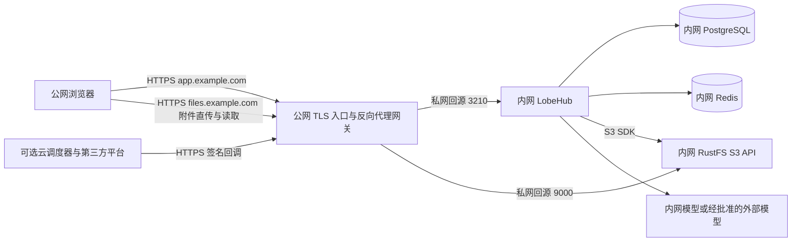

# LobeHub 内网服务器部署改造分析

分析日期：2026-10-30。代码基线：`049c81d53b0c2282eabf1edca2d90d58ad1f60f0`，项目版本 `2.2.1`。

目标架构为：用户通过公网域名访问，入口完成 HTTPS 证书终止及网关转发，应用、数据库和文件存储运行在内网服务器。本分析区分部署配置、部署文件调整和业务代码改造，作为后续实施范围的依据。

## 1. 结论与部署边界

**现有项目可以运行在“公网 HTTPS → 网关 → 内网 HTTP 应用”架构下，不需要因为应用位于内网就整体重写。必须先解决公网地址与内部地址的职责、附件访问链路、网关长连接、数据服务端口和按功能产生的外部回调。**

RustFS 是最需要先确定边界的部分：当前对话附件采用浏览器直传 S3，下载入口 `/f/:id` 也只是跳转到 S3。因此，“RustFS 服务部署在内网”可以通过网关开放其数据接口完成；“RustFS 的 S3 API 完全不可从公网访问”则必须改上传和下载代码。`S3_PUBLIC_DOMAIN` 不能单独解决这个问题。

本文采用以下首期假设：

- 公网使用独立应用域名，例如 `https://app.example.com/`，挂在域名根路径。
- 网关能够通过专线、VPN、隧道或已有私网链路访问内网回源；仅配置 DNS 和证书不会自动建立这条网络链路。
- 内网服务器允许按白名单访问必要外部服务。完全禁止出网的差异见第 9 节。
- 初期使用单个常驻应用副本，保留 PostgreSQL、Redis 和 RustFS；高可用及可靠后台任务另外实施。
- 示例域名、端口和变量用于确定接口契约，落地时替换为真实地址与生成的密钥。

如果最终要求只有一个公网应用入口、存储 API 完全不对外提供服务，应直接选择第 4.4 节的应用代理方案。

## 2. 目标拓扑与网络访问矩阵

### 2.1 首期方案

应用和 RustFS 均在内网，公网入口提供两个 HTTPS 虚拟主机，可由同一套网关承载。



图中的 S3 SDK 连线表示逻辑依赖：当前只有一个 `S3_ENDPOINT`，配成公网域名后，应用也会访问该域名。要让这部分流量实际走私网，需要同域名内外分离 DNS，或者第 4.3 节的双 endpoint 改造。

### 2.2 谁需要访问哪个地址

| 调用方 | 访问目标 | 约束 |
| --- | --- | --- |
| 公网浏览器 | 应用域名、附件域名 | 必须公网可达且为 HTTPS；不能返回容器名或 RFC1918 地址 |
| 公网网关 | 内网应用 3210、计划开放的 S3 数据面 9000 | 只允许可信网关回源；确认路由、防火墙、带宽与连接时长 |
| LobeHub 容器 | PostgreSQL、Redis、S3、模型、SMTP 等 | 使用容器网络或私网地址；分别验证 DNS、端口、证书 |
| 应用内部调用 | 自身 `/trpc/async` 等 | 使用 `INTERNAL_APP_URL`，避免公网回环和额外入口鉴权 |
| 外部模型或云沙箱 | 作为 URL 传入的附件、沙箱文件回传地址 | 必须从该外部服务可达；仅浏览器能访问不够 |
| 云 QStash 等调度器 | 公网任务接收路由 | 使用外部可达的回调地址与服务签名；不能指向 localhost |
| 管理员 | RustFS Console、数据库、Redis | 限管理网或 VPN；不发布到公网业务入口 |

“只需对公网开放应用网站”和“所有功能都不需要外部连接”是两个独立条件。附件直传、模型取图、云任务回调要逐条验证。

## 3. 改造清单与优先级

P0 表示上线前必须完成；P1 表示启用对应功能或满足对应要求时必须完成；P2 表示规模和运维优化。

| 优先级 | 范围 | 必须完成的工作 | 性质 |
| --- | --- | --- | --- |
| P0 | 网络与入口 | 打通网关至内网回源；应用域名配置 DNS、TLS、证书续期 | 基础设施配置 |
| P0 | 地址职责 | `APP_URL` 为公网 HTTPS；`INTERNAL_APP_URL` 为实际调用方可达的内部地址 | 环境配置 |
| P0 | 网关 | 整站路由透传、可信转发头、SSE、上传大小和超时、动态响应不缓存 | 网关配置 |
| P0 | 文件存储 | 选择 S3 数据面经网关开放，或实现应用上传下载代理 | 架构选择；后者改代码 |
| P0 | RustFS 初始化 | 移除凭据日志；校正 bucket 名与 policy；按附件访问要求设置匿名读策略 | 部署文件调整 |
| P0 | 内网数据服务 | 收敛 PG、Redis、RustFS Console 的宿主端口与防火墙 | 部署文件调整 |
| P0 | 数据库与密钥 | 使用正确 PG 驱动和扩展；迁移、持久化、备份并固定加密密钥 | 配置与运维 |
| P0 | 模型链路 | 应用可达模型；公网浏览器不直接访问内网模型地址 | 配置，按 provider 验证 |
| P0 | 发布 | 固定镜像版本，形成可回滚的内网部署清单和端到端验收 | 部署工程 |
| P1 | 私有附件 | 如果要求用户间隔离，补足 `/f/:id` 的访问控制及外部服务临时访问机制 | 代码改造 |
| P1 | 存储内外地址分离 | 如果需要 SDK 直连内网且签名发公网，新增双 endpoint，或使用同域分离 DNS | 代码或网络配置 |
| P1 | 云异步任务 | 校正各工作流回调地址；保留签名验证和非交互式入口 | 部分代码改造 |
| P1 | 可靠后台任务 | 如果要求重启恢复、多副本、可靠延迟任务，落地持久队列和共享状态 | 代码及服务改造 |
| P1 | 登录与客户端 | 配置启用的 SSO、SMTP、Passkey、Desktop/CLI OIDC | 主要是配置与联调 |
| P1 | 搜索与知识库 | 配置搜索、爬虫、解析器、embedding 的可达服务 | 配置；部分替代服务 |
| P1 | 远程设备 | 内网保留设备能力时处理 Cloudflare Durable Objects 运行环境依赖 | 服务迁移或兼容运行环境 |
| P1 | 完全禁止出网 | 替换云依赖、离线依赖包与资源；PDF 导出字体本地化 | 配置及明确代码改造 |
| P1 | 公网子路径 | 如果必须使用 `/lobehub/`，统一前后端路径、资源和认证回调 | 跨层代码改造 |
| P2 | 高可用与观测 | 多副本、集中日志、容量告警、灾备恢复演练 | 代码验证与运维 |

## 4. RustFS 与附件链路

### 4.1 当前实现

文件链路的关键代码如下：

| 链路 | 当前行为 | 代码依据 |
| --- | --- | --- |
| 浏览器上传 | 从应用取得 presigned URL，再由 XHR 直接 PUT 到 S3 | [upload.ts](src/services/upload.ts#L147) |
| S3 SDK | 读、写、删除与签名共用一个 `S3Client`，endpoint 来自 `S3_ENDPOINT` | [S3/index.ts](src/server/modules/S3/index.ts#L53) |
| 上传签名 | 使用同一 client 生成 PUT URL | [createPreSignedUrl](src/server/modules/S3/index.ts#L135) |
| 下载签名 | 使用同一 client 生成 GET URL | [createPreSignedUrlForPreview](src/server/modules/S3/index.ts#L145) |
| `S3_PUBLIC_DOMAIN` | 只有启用 `S3_SET_ACL` 且设置该域名时，才拼接普通读取 URL；否则仍返回签名地址 | [getFullFileUrl](src/server/services/file/impls/s3.ts#L143) |
| `/f/:id` | 根据文件 ID 查记录，生成短期 S3 URL，返回 302；没有转发文件字节 | [文件入口](<src/app/(backend)/f/[id]/route.ts#L58>) |

由此可知，`S3_ENDPOINT=http://rustfs:9000` 只满足容器内部访问，无法满足公网浏览器直传。把 `S3_PUBLIC_DOMAIN` 改成公网域名，也不会改变 PUT 签名使用的 endpoint。

### 4.2 方案 A：S3 数据接口通过网关开放

这是保留现有上传方式、代码改动最少的方案。

```dotenv
# LobeHub 容器内的存储配置
S3_ENDPOINT=https://files.example.com
S3_BUCKET=lobe
S3_ENABLE_PATH_STYLE=1
S3_SET_ACL=0
S3_ACCESS_KEY_ID=<应用专用访问密钥>
S3_SECRET_ACCESS_KEY=<应用专用秘密密钥>
```

这里的 `S3_SET_ACL=0` 表示代码不为对象设置 public-read，**不会撤销已有 bucket 的匿名读 policy**。私有 bucket 需要另行移除匿名读授权。使用私有签名模式时，不依赖 `S3_PUBLIC_DOMAIN`。

网关和存储必须满足以下条件：

1. `files.example.com:443` 回源内网 RustFS `9000`，不把 Console `9001` 暴露到这个域名。
2. 保持签名时使用的 `Host`、对象路径、查询参数和请求体；避免增加 `/s3` 前缀、重写对象路径、丢失 `X-Amz-*` 参数或重定向 PUT。
3. 通过必要的 PUT、GET、HEAD、OPTIONS；服务端删除还需 DELETE，批量删除等操作还需 POST。按实际 API 和策略开放相应操作，不能只允许浏览器上传涉及的方法。
4. 在 RustFS 设置浏览器应用 Origin 白名单，确保真实 PUT 预检通过，并保留所需请求头与响应头；CORS 不是对象访问授权。
5. 明确文件大小、网关 request buffering、超时、带宽和 Range 读取策略；私有内容与签名重定向不进入共享缓存。
6. 应用容器也必须能解析并访问 `https://files.example.com`。如果网络不允许访问公网入口，应配置分离 DNS 或采用方案 B。

AWS SigV4 将 Host 纳入签名，不能先对 `http://rustfs:9000` 签名，再把 URL 字符串中的域名替换为公网域名。[AWS 签名说明](https://docs.amazonaws.cn/en_us/AmazonS3/latest/developerguide/sigv4-query-string-auth.html)

RustFS 当前官方文档提供 `RUSTFS_CORS_ALLOWED_ORIGINS=https://app.example.com`，应配置在 **RustFS 容器**，并按最终固定的 RustFS 版本验证预检行为。不要把它写入应用容器后认为已生效。[RustFS CORS 配置](https://docs.rustfs.com/en/administration/cors)

### 4.3 方案 B：内部 SDK endpoint 与外部签名 endpoint 分离

当需要避免服务端文件读写绕经公网网关时，可选择：

- **同一个 FQDN、内外分离 DNS**：公网解析到公网网关，应用所在网络解析到私网 HTTPS 入口；URL、Host 和证书仍保持 `files.example.com`。这是保留单 client 的网络方案。
- **双 S3 client**：服务端读写使用内网 endpoint，生成浏览器或第三方使用的签名时使用公网 endpoint。这需要改代码。

双 client 的建议改造范围：

| 文件或层 | 工作内容 |
| --- | --- |
| `src/envs/file.ts` | 明确内部 endpoint 与签名 endpoint 的新配置、回退规则、region 和 path-style 一致性 |
| `src/server/modules/S3/index.ts` | 分离操作 client 和签名 client；PUT/GET 签名都使用外部 client |
| 文件服务及 URL 缓存 | 检查预览、删除、媒体处理、缓存刷新和历史 key 转换 |
| 对应测试 | 验证内部 SDK 使用私网地址，签名使用公网 Host，现有单 endpoint 配置仍兼容 |

这些是拟新增能力，当前仓库没有可直接配置的“公网签名 endpoint”变量。`S3_PUBLIC_DOMAIN` 不等价于这个能力。

### 4.4 方案 C：RustFS S3 API 完全不对公网提供服务

如果只允许应用入口对公网开放，必须把应用改成文件数据代理：

- 新增鉴权上传端点，浏览器上传至应用，应用以内部 S3 SDK 写入 RustFS；调整当前上传服务，保持进度、取消、错误和大小限制行为。
- 将 `/f/:id` 的 302 改为授权后的流式下载，处理 HEAD、Range、Content-Type、Content-Disposition、中文文件名、客户端取消与大文件内存占用。
- 为外部模型取附件设计短期、限定文件与用途的令牌入口；此入口仍走应用公网域名，不要求 RustFS API 开放。
- 改造外部沙箱文件回传：不能继续把不可达的 S3 PUT URL 交给外部服务，应使用受控应用上传入口或由内网执行器回收文件。
- 按文件流量重新评估应用的连接数、带宽、网关限制和扩缩容。

仅把 `/f` 改成下载代理仍不完整：浏览器上传和外部沙箱回传也需要一并处理。

### 4.5 默认部署文件需要处理的具体问题

当前 [部署 Compose](docker-compose/deploy/docker-compose.yml#L82) 和 [bucket policy](docker-compose/deploy/bucket.config.json) 存在以下与目标环境直接相关的行为：

- `9000` 和 `9001` 均发布为宿主端口。9000 只允许计划中的网关或应用访问；9001 限管理网，或者取消发布。
- 初始化命令使用 `set -eux`，并显式打印 S3 密钥。必须移除凭据输出及包含凭据的 shell trace。
- `RUSTFS_LOBE_BUCKET` 用于应用配置，但初始化创建 bucket 和匿名策略仍硬编码为 `lobe`。使用自定义 bucket 时，应同步创建命令和 policy Resource。
- 默认 policy 允许匿名 `s3:GetObject`。如果附件属于私有资料，必须移除该授权，并验证匿名对象读取失败。
- 应用和 RustFS 初始化目前共用部署凭据。生产应区分初始化管理权限与应用所需的 bucket 对象读写权限。

此外，[当前 `/f/:id` 实现](<src/app/(backend)/f/[id]/route.ts#L23>) 明确允许按 ID 公开取文件，没有用户会话或所有权过滤。私有 bucket 只能保护直接对象入口，不能让这个应用入口自动具备用户隔离。若业务要求私有资料，必须为登录用户、分享访问和模型访问分别设计授权，避免永久文件 ID 成为长期通行证。

### 4.6 模型取图、沙箱和历史附件

`LLM_VISION_IMAGE_USE_BASE64=1` 可以在部分模型上下文转换路径中，由服务端读取图片再转 base64；不能据此认定所有 provider、视频、生图和沙箱都支持不可达的内网 URL。视频转换失败还可能回退原 URL。[模型上下文转换](packages/model-runtime/src/core/contextBuilders/openai.ts#L46)

[云沙箱文件导出](src/server/services/sandbox/index.ts#L117) 会向外部服务提供 S3 presigned PUT URL，这条链路仍要求外部可达，或采用方案 C 的回传改造。聊天、图片生成、视频生成应分别验收。

已有附件可能保存对象 key、历史完整 URL 或 `/f/:id`。虽然 [S3 文件服务](src/server/services/file/impls/s3.ts#L132) 有旧 URL 转 key 的兼容逻辑，变更域名、bucket 或路径格式时仍要抽查头像、历史消息、知识库、图片和视频。切换后重启应用，并按相关命名空间失效旧签名缓存，避免继续返回旧域名；不要清空整个业务 Redis。

## 5. 公网地址、网关与鉴权

### 5.1 应用地址与内部调用地址

[应用环境配置](src/envs/app.ts#L20) 已区分两者：

```dotenv
APP_URL=https://app.example.com
INTERNAL_APP_URL=http://localhost:3210
```

`APP_URL` 必须为用户实际访问的 HTTPS 地址，不带尾部 `/`。它会用于登录跳转、回调、附件永久入口等。`INTERNAL_APP_URL` 的 localhost 只适合调用发生在同一应用容器中的情况；独立 worker 或其他容器应使用其可达的应用服务地址。

默认 Compose 在 `environment` 中显式设置 `INTERNAL_APP_URL=http://localhost:3210`，其优先级高于 `env_file`。后续调整时应同步修改 Compose，不能只改 `.env`。[现有配置](docker-compose/deploy/docker-compose.yml#L17)

Dockerfile 已默认启用 `MIDDLEWARE_REWRITE_THROUGH_LOCAL=1`，现有 [rewrite 实现](src/libs/next/proxy/define-config.ts#L74) 可把内部页面重写送回本容器。沿用镜像时保留该配置；自定义部署按回源行为验证，不必为这一能力重新写中间件。

### 5.2 网关转发契约

| 项目 | 必须满足的行为 |
| --- | --- |
| 路由 | 整站转发至应用，覆盖 `/api`、`/webapi`、`/trpc`、`/f`、`/oidc`、登录页面、SPA 深层路由、`/_spa`、`/_next` 等 |
| 方法与正文 | 保留原请求方法、query、body、Authorization、Cookie、Set-Cookie 和原始签名回调正文 |
| 公网身份 | 传递正确的 Host、`X-Forwarded-Host`、`X-Forwarded-Proto=https` 和客户端 IP |
| 信任边界 | 公网边缘覆盖或规范化客户端伪造的转发头；应用回源端口仅接受可信入口 |
| 多层代理 | 内层代理保留经验证的外层 HTTPS 信息，不能用本层 HTTP `$scheme` 覆盖公网协议 |
| 错误处理 | 不将 API、签名失败和资源 404 改写成 SPA HTML 或登录页 |
| 缓存 | 会话、鉴权响应、私有附件、SSE、签名 URL 与重定向不进入共享缓存 |
| 上传 | 入口 body 限制、应用限制与实际文件上限一致，验证大文件和长耗时上传 |

现有前端使用根绝对 API 路径，[Vite 生产资源](vite.config.ts#L104) 默认位于 `/_spa/`。因此首期采用独立域名根路径。仅增加网关 `/lobehub/` 前缀，或设置 `NEXT_PUBLIC_ASSET_PREFIX`，不能保证整个 SPA 正常工作。强制子路径时必须统一 Router basename、API URL、Vite base、Next 资源、重定向、Cookie path 与 OAuth 回调。

### 5.3 登录与证书终止

当前使用 Better Auth，[baseURL 来自 `APP_URL`](src/libs/better-auth/define-config.ts#L105)。普通 HTTPS 入口转发 HTTP 回源无需重写鉴权系统，也不要套用旧版 NextAuth 配置。

- 单一 Web Origin 通常沿用默认可信列表即可。设置 `AUTH_TRUSTED_ORIGINS` 时，它会**覆盖**默认列表；如果保留移动端或 Apple 登录，要一并保留所需 Origin。[可信列表实现](src/libs/better-auth/utils/config.ts#L35)
- 在 SSO 提供商注册准确的公网回调。内置 provider 通常使用 `/api/auth/callback/{provider}`；generic OAuth 的配置和注释存在路径差异，需要按实际启用的插件路由联调，不能只照注释复制。
- 如果使用内网 IdP，浏览器需可达授权端点，应用需可达 discovery、token、userinfo 和 JWKS 等服务；仅将应用公开不能解决 IdP 的网络可达性。
- 验证真实 Set-Cookie、登录、退出和过期行为，保持安全 Cookie；不以关闭 Secure 处理协议识别错误。
- Passkey 的 RP ID 与 Origin 从 `APP_URL` 派生。域名迁移时应考虑已有凭据重新登记。[Passkey 配置](src/libs/better-auth/define-config.ts#L58)
- 如需 Desktop/CLI，透传 OIDC 相关路由并生成、持久化专属 `JWKS_KEY`，不要直接沿用示例中的固定密钥。当前 OIDC provider 使用 `APP_URL/oidc` 并启用代理模式。[OIDC provider](src/libs/oidc-provider/provider.ts#L320)

## 6. SSE 与可选业务网关

聊天和 Agent 流使用 SSE。项目 [SSE 响应](packages/utils/src/server/sse.ts#L141) 已设置 `text/event-stream`、`no-cache, no-transform` 和 `X-Accel-Buffering: no`，但网关仍需保证：

- 关闭对应流式路径的响应缓冲、缓存和会聚数据的转换，逐块传递响应。
- 读空闲超时覆盖真实模型的静默时长，并核对最外层 WAF、CDN 或负载均衡器的总时长限制。
- 验证取消请求、断线重连和较长任务；不能以普通 API 200 作为流式验收。

Nginx 可通过 `proxy_buffering off`、`proxy_cache off`、合理的 `proxy_read_timeout` 等实现上述行为；应用的 `X-Accel-Buffering` 也可能被网关配置忽略。具体参数按现有网关产品和任务时长落地。[Nginx 代理文档](https://nginx.org/en/docs/http/ngx_http_proxy_module.html)

本项目中的以下“Gateway”与公网反向代理网关不是同一个服务：

| 配置 | 用途 | 内网部署影响 |
| --- | --- | --- |
| `AGENT_GATEWAY_URL` | Agent 实时事件等可选能力 | URL 会下发客户端；启用时需要公网可达 HTTPS/WSS 入口和服务 token |
| `DEVICE_GATEWAY_URL` | 远程设备与工具调用 | 启用时验证应用、设备与网关的连接；当前 `apps/device-gateway` 使用 Cloudflare Durable Objects |
| `MESSAGE_GATEWAY_URL` | 外部消息网关 | 仅选择外部模式才依赖；项目也有本地 GatewayManager，但仍需连接相应 IM 平台 |

WebSocket 只在启用这些需要它的服务时处理 Upgrade、Connection、心跳和超时；它不能替代 SSE 配置。[Nginx WebSocket 文档](https://nginx.org/en/docs/http/websocket.html)

设备网关不是将目录直接打包成普通 Node 容器即可内网运行的现成服务。若必须完全内网保留设备能力，需要迁移 Durable Objects 的会话和状态实现，或部署兼容运行环境并验证。[运行环境配置](apps/device-gateway/wrangler.toml#L5)

## 7. 异步任务与外部回调

### 7.1 本地执行与可靠队列

项目默认已经有本地队列实现；只有 `AGENT_RUNTIME_MODE=queue` 才使用 QStash 并要求 token。[队列工厂](src/server/services/queue/impls/index.ts#L18)

本地实现使用进程内 `setTimeout`，其待执行调度不具备进程重启后的持久性。即使配置 Redis，非 queue 模式的部分 Agent 状态仍在内存中，不能把“接上 Redis”视为已完成多副本高可用。[本地实现](src/server/services/queue/impls/local.ts#L39)、[状态工厂](src/server/modules/AgentRuntime/factory.ts#L33)

- 首期单副本可采用本地执行，明确停机期间未完成任务的处理方式。
- 如果需要可靠后台执行，可保留云 QStash 并开放签名回调；或者实现内网持久队列与 worker，覆盖重试、取消、幂等、共享状态、流事件与重启恢复。
- 不应把 QStash 开发服务直接视为已验证的生产替代，也不能仅替换一个环境变量就宣称所有 Workflow 已内网化。

### 7.2 回调地址来源不统一

| 链路 | 当前地址来源 | 在目标架构下的处理 |
| --- | --- | --- |
| 内部 async tRPC | `INTERNAL_APP_URL` | 保留内网地址，用于服务自身调用 |
| Agent runtime queue | `AGENT_RUNTIME_BASE_URL`，否则 `APP_URL`，再拼 `/api/agent` | 云执行器需要公网可达地址 |
| AgentSignal Workflow | 优先 `INTERNAL_APP_URL`，再 `APP_URL` | 默认 Compose 的 localhost 会被交给云 Workflow，启用此链路前必须修正 |
| Eval Workflow | `process.env.APP_URL` | 保持公网 HTTPS 地址并验证云回调 |
| Task schedule queue | `APP_URL` 的工作流路径 | 验证外部调度入口和签名；非 queue 分支存在直接执行方式 |
| qstash 类型 Hook | 相对目标优先内部地址 | 按执行器位置判断可达性，不能将内网相对目标交给云任务 |

依据：[Agent runtime](src/server/services/agentRuntime/AgentRuntimeService.ts#L148)、[AgentSignal](src/server/workflows/agentSignal/index.ts#L21)、[Eval](src/server/workflows/agentEvalRun/index.ts#L126)、[Task dispatch](src/server/workflows-hono/task/handlers/scheduleDispatch.ts#L101)、[Hook dispatcher](src/server/services/agentRuntime/hooks/HookDispatcher.ts#L27)。

**建议为外部执行器引入独立回调基址，并逐条修正使用处，保留 `INTERNAL_APP_URL` 的内部调用职责。** 不能为了修复 AgentSignal，就把所有内部调用统一改走公网。

关闭 `AGENT_RUNTIME_MODE=queue` 只改变对应 Agent runtime 队列，不会自动取消 AgentSignal、Eval、记忆等全部 Workflow 依赖。按实际功能禁用、替换或开放回调。

### 7.3 回调认证与定时触发

云端调用的 `/api/agent/*`、`/api/workflows/*`、Webhook 等路径不能被入口交互式 SSO 或验证码拦截，应保留应用自身的服务签名认证。启用 QStash 时成对配置 `QSTASH_CURRENT_SIGNING_KEY` 和 `QSTASH_NEXT_SIGNING_KEY`，验证非法签名被拒绝。当前不同中间件缺失签名配置时的处理不同，不能假设缺配置都会安全失败。[签名实现](src/libs/qstash/index.ts#L37)、[Workflow 中间件](src/server/workflows-hono/middlewares/qstashAuth.ts#L24)

任务 heartbeat、schedule-dispatch、watchdog 的接收接口存在，不代表 Compose 自动提供了周期调用。保留定时功能时，应接入企业调度平台、内网 cron 或已验证的云 schedule，配置服务认证、时区、幂等和告警。[任务入口](src/server/workflows-hono/task/index.ts#L12)

## 8. 数据库、模型与知识库

### 8.1 PostgreSQL 与 Redis

- 普通内网 PostgreSQL 应使用 `DATABASE_DRIVER=node`；源码默认值为 `neon`，现有 Dockerfile 已覆盖为 `node`。自定义启动或镜像时需要显式确认。[驱动配置](src/config/db.ts#L7)、[Dockerfile](Dockerfile#L162)
- 当前迁移需要 `vector` 和 `pg_search`，不能把 Compose 的 ParadeDB 直接换成不带扩展的裸 PostgreSQL。[vector 迁移](packages/database/migrations/0005_pgvector.sql#L2)、[pg_search 迁移](packages/database/migrations/0090_enable_pg_search.sql#L2)
- `DATABASE_URL`、`KEY_VAULTS_SECRET` 必须完整。已有数据迁移时保留原加密密钥，多副本保持一致；同时备份数据库、对象数据、认证及签名密钥。
- Redis 对基础单进程模式并非全部链路的硬依赖，但生产建议保留；queue 模式需要它管理相关状态和流事件。多副本时还需验证所有状态是否可共享。
- 当前 Compose 发布宿主 `5432` 和 `6379`。同 Docker 网络通信无需发布；其他内网服务访问时绑定指定私网接口并配置访问限制。[部署文件](docker-compose/deploy/docker-compose.yml#L40)

### 8.2 模型服务

内网模型通常只需对应用开放，无需暴露给公网浏览器。按 provider 配置 `OPENAI_PROXY_URL`、`OLLAMA_PROXY_URL` 等服务端地址，实际变量以 [ModelRuntime](src/server/modules/ModelRuntime/index.ts#L181) 为准。

特别注意 Ollama：未配置 `OLLAMA_PROXY_URL` 时，Web 配置可能启用 `fetchOnClient`。公网浏览器无法直接访问企业内网 Ollama，应将请求切到服务端并检查浏览器 Network。[全局配置](src/server/globalConfig/index.ts#L66)

除了主聊天模型，还要核对 embedding、标题摘要、视觉、音频、图片视频生成和记忆提取。某些子功能有独立 base URL 或模型配置，不能只替换主模型就认为全部内网化。

### 8.3 搜索、抓取与知识库

Compose 已有内网 SearXNG，但它本身仍需连接所配置的搜索引擎。内网部署 SearXNG 不等于完全离线搜索。

爬虫默认实现包含 Jina 等外部服务。仅抓内网站点可按范围配置 `CRAWLER_IMPLS=naive`；动态页面可自建 Browserless 或其他支持的解析器。复杂文档解析另行配置 `UNSTRUCTURED_SERVER_URL`；知识库验收应覆盖上传、解析、切块、embedding、入库和检索。[爬虫实现](packages/web-crawler/src/crawler.ts#L7)、[工具配置](src/envs/tools.ts#L10)、[解析配置](src/envs/knowledge.ts#L4)

使用 SSRF 防护 fetch 的路径默认限制私网 IP。对于批准的内网爬取地址，优先使用 `SSRF_ALLOW_IP_ADDRESS_LIST` 的精确名单，并结合防火墙限制。不要为方便抓取而全局开启 `SSRF_ALLOW_PRIVATE_IP_ADDRESS=1`：实现同时放开 metadata IP。该设置也不是所有 SDK、模型或 MCP 请求的统一网络开关。[实现](packages/ssrf-safe-fetch/index.ts#L72)

如果内部 HTTPS 服务使用企业 CA，应向调用容器提供可信 CA，例如使用镜像支持的 `NODE_EXTRA_CA_CERTS`，而非关闭 TLS 校验。浏览器访问的公网域名仍应提供浏览器信任的证书。[镜像证书配置](Dockerfile#L140)

## 9. 外部依赖与完全禁止出网的差异

下表为按功能处理的依赖，不代表基础 Web 聊天必须保留所有服务。

| 能力 | 当前依赖或配置入口 | 完全禁止出网时 |
| --- | --- | --- |
| 模型 | provider API 与独立 embedding、视觉等模型 | 切换到具备相应能力的内网服务并逐项验证 |
| Market 与云沙箱 | `MARKET_BASE_URL`，默认外部市场 | 禁用相关能力或建设兼容内网服务；仅镜像索引不能替代沙箱 |
| Agent 与插件索引 | `AGENTS_INDEX_URL`、`PLUGINS_INDEX_URL` | 镜像索引，并继续检查插件清单中的真实 API 和资源地址 |
| MCP | HTTP/SSE 服务或 stdio 子进程 | 自建端点、预装依赖与运行时，消除运行时 npx 下载依赖 |
| OAuth/SSO | IdP discovery、token、userinfo 等 | 内网 IdP，且满足浏览器和应用各自的访问要求 |
| 账户邮件 | `EMAIL_SERVICE_PROVIDER=nodemailer`、`SMTP_*` | 接入可达的内网 SMTP，验证注册、找回密码和通知 |
| 云任务 | QStash 与 Workflow | 内网持久执行器或停用相应功能；逐条改回调和调度 |
| 搜索与网页抓取 | 搜索引擎、Jina、Browserless 等 | 改为企业内容源和内网抓取服务，或停用外网搜索 |
| PDF 导出 | 服务端首次导出从 jsDelivr 下载中文字体 | **需要代码改造**：打包字体进镜像，或增加受控内网字体地址 |
| 浏览器资源 | 实际构建产物、第三方字体、图标、用户配置资源 | 冷缓存断网验收，必要时镜像或打包资源；不能仅靠修改 Next assetPrefix |
| 统计与链路追踪 | 多种 analytics、Sentry、Langfuse、OpenTelemetry | 分别关闭或转向内网采集端，核对浏览器与服务端出网 |
| 设备与 IM | Durable Objects、外部 IM 连接或回调 | 迁移运行环境或停用；本地 message manager 仍需连平台 |

明确的代码证据包括：[Market 默认入口](src/server/services/market/index.ts#L11)、[索引地址](src/envs/app.ts#L32)、[MCP client](src/libs/mcp/client.ts#L45)、[邮件配置](src/envs/email.ts#L24)、[硬编码 PDF 字体](src/server/routers/lambda/exporter.ts#L25)。

`TELEMETRY_DISABLED=1` 不是“所有外部连接关闭”开关。还应检查 `NEXT_PUBLIC_SENTRY_DSN`、analytics、`ENABLE_LANGFUSE`、`ENABLE_TELEMETRY` 等各自配置，以及镜像构建时写入的前端变量。[统计配置](src/envs/analytics.ts#L37)

完全断网还需要内网镜像仓库、包仓库或预构建产物，覆盖 Node 基础镜像、pnpm 依赖、原生二进制、数据库镜像与扩展、MCP 工具等。应验证断网后的冷启动、首次导出和首次工具调用，不能只测已有缓存的进程。

## 10. 部署配置基线

以下为单应用容器、S3 数据面通过网关开放的应用配置基线；不是可以直接替代 Compose 的完整配置。

```dotenv
APP_URL=https://app.example.com
INTERNAL_APP_URL=http://localhost:3210

DATABASE_DRIVER=node
DATABASE_URL=postgresql://<用户>:<密码>@postgresql:5432/<数据库>
KEY_VAULTS_SECRET=<生成并持久保存的加密密钥>
AUTH_SECRET=<生成并持久保存的认证密钥>

REDIS_URL=redis://redis:6379
REDIS_PREFIX=lobechat
REDIS_TLS=0

S3_ENDPOINT=https://files.example.com
S3_BUCKET=lobe
S3_ENABLE_PATH_STYLE=1
S3_SET_ACL=0
S3_ACCESS_KEY_ID=<应用专用访问密钥>
S3_SECRET_ACCESS_KEY=<应用专用秘密密钥>

SEARXNG_URL=http://searxng:8080
# 在选择的模型 provider 中配置实际服务地址和认证。
# 首期本地 Agent 执行不设置 AGENT_RUNTIME_MODE=queue。
# 云 Workflow 的保留与关闭仍需按第 7 节分别处理。
```

注意 Compose 中的 `environment` 会覆盖 `env_file`，并且现有模板通过 `RUSTFS_*` 变量注入存储凭据和 bucket。实施时统一变量来源，避免 `.env` 改了但容器实际配置仍被旧值覆盖。

生产部署文件还应完成：

1. 新建专用于内网环境的部署清单及非敏感变量示例，覆盖网关、网络、卷、初始化、健康检查和升级步骤。
2. 固定应用、ParadeDB、RustFS、Redis、SearXNG 和初始化工具的版本或 digest，替换现有 `latest` 或无版本标签。
3. 按网关是否同宿主机，选择仅容器网络、loopback 或指定私网地址发布回源端口；取消不需要的数据服务宿主端口。
4. 区分构建与运行变量；Next 和 Vite 资源相关变量要在正确构建阶段生效。沿用当前构建链包含 SPA、Next 和资源复制步骤，不能只启动前端开发服务器。
5. 持久化数据库、RustFS、必要 Redis 数据与密钥；备份恢复时确保数据库文件记录与对象数据一致。
6. 首次升级前验证数据库迁移。现有容器启动器会执行迁移，多副本发布时安排受控迁移流程。[启动器](scripts/serverLauncher/startServer.js#L185)
7. 设置 readiness、进程存活、依赖连接、磁盘容量及失败任务告警；备份恢复和升级回滚都要有操作步骤。
8. 网关及应用日志不记录明文凭据、Authorization、Cookie 或完整签名查询参数。

## 11. 实施顺序与交付范围

### 第一阶段：形成最小可上线内网部署

确定附件方案和公网域名，建立网关回源链路；修改部署模板，配置公网与内部 URL、SSE、S3 CORS、bucket 策略、端口、模型和持久化。初期采用单应用副本，完成基础聊天、附件和实际登录方式的联调。

这一阶段大部分工作属于配置与部署文件调整。只有明确要求私有附件授权、完全关闭 S3 公网数据接口等条件时，才引入相应业务代码改造。

### 第二阶段：保留功能逐项适配

对云 Workflow、后台任务、知识库、搜索、SSO、邮件、图片视频、MCP、沙箱和远程设备逐项决定保留、内网替代或关闭。优先修正外部回调使用内部 URL 的问题，以及需保留的离线 PDF 字体等已确认代码点。

### 第三阶段：可靠性与扩容

如果有停机恢复、多副本和长任务 SLA，再推进内网持久队列、共享状态、幂等与恢复机制；随后验证负载均衡、流事件跨副本一致性和灾备。单独增加应用副本或 Redis 无法替代这些工作。

## 12. 上线验收清单

按实际保留功能勾选。未启用的功能应有明确产品行为，不让用户进入必然失败的入口。

- [ ] 公网 HTTPS 证书有效且可续期；网关至内网回源链路稳定，绕过可信网关不能直接访问应用回源端口。
- [ ] 首页、移动页面、SPA 深层链接刷新、`/_spa` 和 `/_next` 正常，无混合内容、内网地址泄漏或脚本收到 HTML。
- [ ] 所有登录、注销、邮件链接和重定向使用公网 HTTPS；实际 Cookie、可信 Origin、SSO 回调按启用方式通过。
- [ ] 从公网伪造 `X-Forwarded-*` 不会改变应用认知的协议、域名和客户端 IP，边缘与内层代理的信任规则符合设计。
- [ ] 公网浏览器上传图片、文档和大文件成功；S3 预检、中文文件名、取消和失败反馈符合预期。
- [ ] 附件预览、下载、视频 Range 和历史附件正常；签名过期后不能继续使用旧签名。
- [ ] 单文件删除和批量删除均成功，数据库记录与对象数据的结果一致。
- [ ] 若使用私有资料：匿名对象读取失败；非授权用户无法通过 `/f/:id` 获取他人附件；分享和模型临时访问权限符合设计。
- [ ] 从应用容器验证 DB、Redis、S3、内部 async tRPC、模型和 SMTP 的实际可达性。
- [ ] 公网浏览器不直接请求内网模型；聊天流式响应逐块到达，长任务无异常聚合或 504，取消与重连正常。
- [ ] 图片理解、图片视频生成及外部沙箱文件回传分别通过，不能只用聊天上传成功代替验收。
- [ ] 知识库完成上传到检索的全流程；搜索、内网页面抓取和解析器分别通过。
- [ ] 保留的云 Workflow 回调目标从执行器可达；无 localhost 地址误用；签名缺失或伪造请求被拒绝。
- [ ] 定时任务确有调度源，能触发 heartbeat、schedule 与 watchdog，时区和重复触发行为正确。
- [ ] 若启用业务网关，公网 WSS、认证、心跳、断线重连与设备工具调用正常。
- [ ] 外网无法访问数据库、Redis 和 RustFS Console；日志不含明文密钥或完整签名 URL。
- [ ] 受控重启及失败恢复符合已选择的任务执行模式；多副本要求已验证共享状态和任务幂等。
- [ ] 数据库、对象数据、认证与加密密钥完成一次联合恢复验证。
- [ ] 如要求完全断网：清除浏览器缓存、重启容器后，登录、首次 PDF 导出、知识库和工具首次调用仍可用。

本次结论基于上述代码基线和仓库部署模板。真实域名、网关产品、回源网络及固定镜像版本的配置值，应在实施阶段落入环境专属部署清单，并通过上述端到端验收确认。

## 13. 本地前后端连接内网基础服务

默认开发联调方式为：内网 Docker 只运行 PostgreSQL、Redis、RustFS 和 SearXNG；开发机复制 `.env.example.development.intranet` 为 `.env.development.local`，配置远程依赖后运行 `bun run dev`，本地同时启动 Next.js 和 Vite。浏览器访问本地 `http://localhost:3010`，鉴权和 API 保持本地同源，不需要本地 Docker。端口不能直连时可通过 SSH 隧道访问。完整步骤见 [本地前后端连接内网 Docker 基础服务](docker-compose/dev/README.md)。

可选的仅本地前端方案仍保留：通过 `server` profile 在 Node 22 容器运行远程 Next.js，开发机配置 `DEV_BACKEND_URL` 后运行 `dev:spa`。该方式的调试引导页通过 JSON 读取后端配置，API 和登录保持远程后端同源。

上述两种模式均用于开发，生产仍按前述部署要求实施。多名开发者共享数据服务时，应明确开发数据库、bucket、Redis 命名空间和密钥的归属；现有数据库的 `KEY_VAULTS_SECRET` 必须保持一致。
